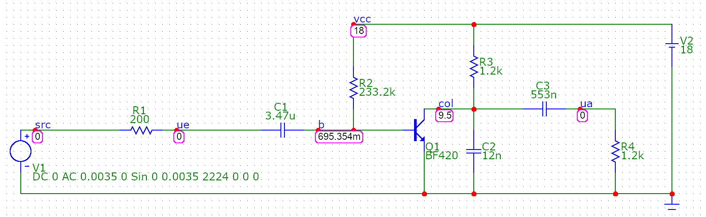
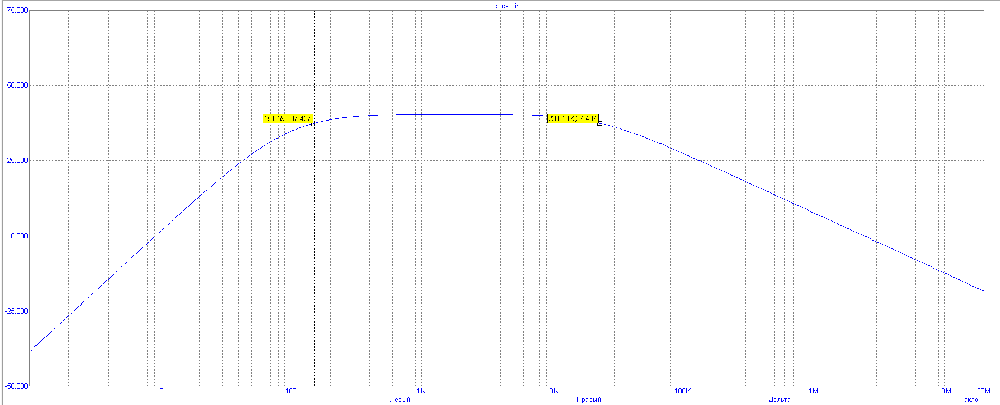
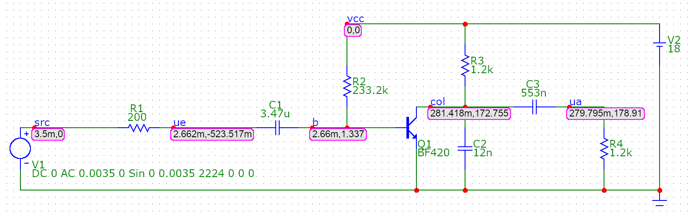
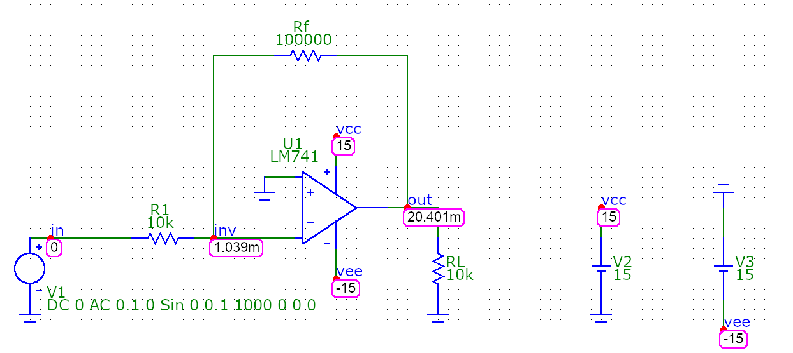
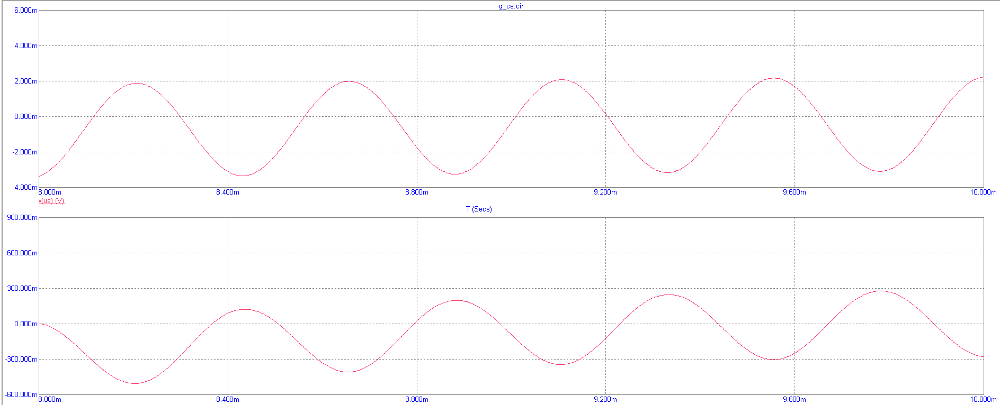
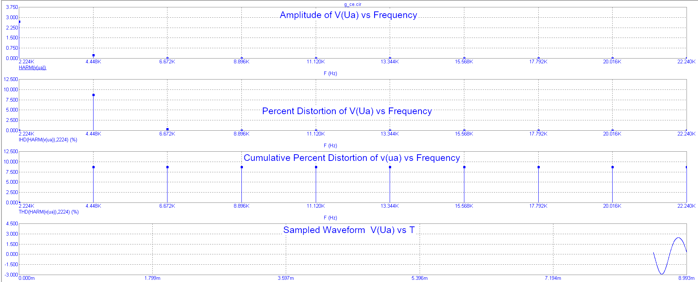

<h1 align="center">mc9py</h1>

<p align="center">
  <b>Script Micro-Cap 9 from Python.</b><br>
  Open or <i>describe</i> a circuit, run analyses, get the numbers, and take screenshots that are <b>MC9's own pictures</b>.<br>
  Linux (sandboxed Wine) · Windows · AI-ready (MCP)
</p>

<p align="center">
  <a href="https://github.com/DontforgetAntaiku/mc9py/actions/workflows/ci.yml"></a>
  <a href="https://DontforgetAntaiku.github.io/mc9py/"></a>
  <a href="https://pypi.org/project/mc9py/"></a>
  
  <a href="LICENSE"></a>
</p>

<p align="center">
  
  
</p>

---

## Why

Micro-Cap 9 is a fast, capable circuit simulator that many universities still teach with - but it has **no scripting interface**:
every lab means clicking through the same dialogs, reading values off cursors and pasting screenshots. `mc9py` automates exactly
that, **using MC9 itself**, so results and pictures are the ones your teacher expects.

- 📷 **Native pictures.** Plots and schematics are screenshots of MC9 - its grid, fonts, cursor tables and voltage boxes. Nothing is re-plotted.
- 🔢 **Real numbers.** Every value is parsed from MC9's own numeric output: operating points, AC / transient / DC tables, THD, Rin, Rout ...
- ✏️ **Circuits from code.** Describe a circuit like a SPICE netlist and get a *placed, routed, collision-free* MC9 schematic; or place parts by hand.
- 🛡️ **Safe by design.** On Linux MC9 runs in a bubblewrap sandbox: no network, no access to your files. Your circuits are copied in, never modified.
- 🪟 **Windows and Linux.** Native Win32 driver on Windows, sandboxed Wine on Linux. One API.
- 🤖 **AI-ready.** A built-in [MCP](https://modelcontextprotocol.io) server lets an assistant build, simulate and photograph circuits for you.

## A 60-second tour

```python
import mc9
from mc9 import Netlist, measure, sources

n = Netlist()                                       # 1. describe a circuit
n.V("V1", "in", "0", sources.sine(0.1, 1e3))
n.R("R1", "in", "out", "1k")
n.C("C1", "out", "0", "159.155n")                   #    RC low-pass, fc = 1 kHz
c = n.build("rc")                                   #    placed + routed + written for MC9

print(c.op().nodes)                                 # 2. DC operating point
r = c.ac(10, 1e5, 401, ["db(v(out))"])              # 3. AC sweep -> numbers
bw = measure.bandwidth(c, "db(v(out))", cursors=True)   # 4. -3 dB point, MC9's cursors placed on it
print(f"{bw.f_high:.1f} Hz")                        #    998 Hz

c.shot("rc_ac.png")                                 # 5. MC9's own plot, cursor table included
c.dynamic_dc(25); c.shot("rc_dc.png", "schematic")  # 6. schematic with node voltages
```

Working on an existing lab file? `c = mc9.open("my_lab/amplifier.cir")` copies it into the work folder; then `c.parts()`,
`c.set("R2", "RESISTANCE", "180k")`, `c.ac(...)`, `c.cursors(...)`, `c.shot(...)`, `c.export(...)` (writes a *new* file).

## Install

### Step 1 - install the Python package

You need **Python 3.10 or newer** and **git**. `pip` is Python's package installer; it comes with Python. Use a *virtual environment*, a private folder for
Python packages that keeps your system clean:

<details open><summary><b>Linux / macOS</b></summary>

```bash
python3 -m venv ~/mc9-env                       # create the environment once
source ~/mc9-env/bin/activate                   # activate it (repeat in every new terminal)
pip install mc9py
mc9 doctor                                      # prints what is installed and what is missing
```
</details>

<details><summary><b>Windows (PowerShell)</b></summary>

```powershell
py -m venv $HOME\mc9-env                        # create the environment once
& $HOME\mc9-env\Scripts\Activate.ps1            # activate it (repeat in every new terminal)
pip install mc9py
mc9 doctor
```
</details>

Want `mc9` available in every terminal without activating anything? Use [pipx](https://pipx.pypa.io) instead:
`pipx install mc9py`.
For development: `git clone https://github.com/DontforgetAntaiku/mc9py && cd mc9py && pip install -e ".[dev]"`.

### Step 2 - connect MC9

<details open><summary><b>Linux</b> (MC9 runs in a sandbox: Wine + virtual display)</summary>

```bash
# 1. system packages: wine, bubblewrap, Xvfb, xdotool, ImageMagick  (package names for Arch / Debian / Fedora: see the docs)
# 2. install MC9 once into a Wine prefix (the default ~/.wine is fine)
WINEPREFIX=~/.wine wine /path/to/mc9-setup.exe
# 3. create the sandbox snapshot (links to your home folders are removed from the copy)
mc9 setup ~/.wine
mc9 doctor                                      # everything should say [ok]
```
</details>

<details><summary><b>Windows</b> (MC9 is driven natively)</summary>

`mc9 doctor` finds `mc9.exe` in the usual install folders. If yours is elsewhere, tell the library once at the top of your script:
`mc9.config.mc9_exe = r"D:\Tools\MC9\mc9.exe"`. Use 100 % display scaling and keep the keyboard and mouse free while a script runs.
More in the [Windows page](https://dontforgetantaiku.github.io/mc9py/getting-started/install-windows/).
</details>

## What it can do

| Area | Features |
|---|---|
| **Circuits** | open (copy) `.cir` files · list / get / set part values · raw `[Limits]` and curve editing · export to a *new* file · display toggles (voltages/currents/power) |
| **Analyses** | operating point · AC (log sweep) · transient (steady-state windows) · DC sweep (temperature lists, several runs) · Distortion window · Dynamic DC · Dynamic AC phasors |
| **Data** | `Result`/`Run`/`OP`: `value_at`, `cross`, `peak`, `trough`, `amplitude`, `mean`, CSV export · device tables (`IC`, `GM`, `RPI`, power ...) · SI-suffix parsing, `N/A` handling |
| **Pictures** | plot / schematic / window screenshots · tight automatic crops · cursors placed at exact X values with MC9's own cursor table · maximized plot windows · failure screenshots with MC9's error dialog |
| **Measurements** | `bandwidth` (-3 dB, low/high/band-pass) · `gain_at` · `rin` · `rout` (load removal) · `thd` (steady-state DFT) · `solve` (find the part value that hits a target) |
| **Schematics** | `Schematic` builder (catalog: R C L V VB I D Q QP M OPAMP GND) · automatic label placement · `check()` / `audit()` / `pin_nets()` · auto centre & zoom · T-junction and node-name handling |
| **Auto-placement** | SPICE-like `Netlist` → backbone + branches + rail/ground buses, label fallback to avoid crossings · verified net-for-net against your netlist · starter circuits in `mc9.library` |
| **Platforms** | Linux: sandboxed Wine + Xvfb · Windows: Win32 API (language independent) |
| **AI** | MCP server with 24 tools (files, analyses, cursors, screenshots, measurements, `build_netlist`, `build_schematic`) |
| **Tooling** | `mc9 setup / doctor / reset / mcp` · 37 offline tests (run on Linux, Windows, macOS CI) · opt-in MC9 integration tests · MkDocs site · GitHub Actions CI |

<p align="center">
  
  
</p>
<p align="center">
  
  
</p>

## Automatic placement in one picture

```python
n = mc9.library.ce_amplifier().build("amp")     # a common-emitter stage from the starter library
# or write your own:
n = Netlist()
n.V("V1", "src", "0", sources.sine(3.5e-3, 2224)); n.R("R1", "src", "ue", "200"); n.C("C1", "ue", "b", "3.47u")
n.R("R2", "vcc", "b", "233.2k"); n.Q("Q1", c="col", b="b", e="0", model="BF420"); n.R("R3", "vcc", "col", "1.2k")
n.C("C3", "col", "ua", "553n"); n.R("R4", "ua", "0", "1.2k"); n.VB("V2", "vcc", "0", "18")
c = n.build("amp")                              # VB = 0.695 V, VC = 9.5 V, IC = 7.09 mA - as in the textbook calculation
```

How the placer works, in short: classify nodes → lay the **signal backbone** left to right → hang **branches** to ground (down) and
rails (up) → draw **buses** → if wires would cross, that net falls back to **named labels** (MC9 joins equally named nodes) → check
collisions with MC9's voltage boxes and re-space. Every generated drawing is verified to have exactly the nets of your netlist.

## Use it from an AI assistant

This is optional. It lets an AI assistant such as [Claude Code](https://claude.com/claude-code) or Claude Desktop drive MC9 through
the library. You need the `mcp` extra, and the assistant must be able to *start the `mc9` program*:

```bash
# 1. install with the extra (inside your activated environment from Step 1)
pip install "mc9py[mcp]"

# 2. find out where the mc9 program lives - you will paste this path below
which mc9                                   # Windows PowerShell:  (Get-Command mc9).Source
#   e.g.  /home/you/mc9-env/bin/mc9    or    C:\Users\you\mc9-env\Scripts\mc9.exe
```

**Claude Code** - run this once in an ordinary terminal (not inside Python), using the path from step 2:

```bash
claude mcp add microcap9 -- /home/you/mc9-env/bin/mc9 mcp
claude mcp list                              # microcap9 should be listed; start `claude` and ask away
```
(If `mc9` is on your `PATH`, e.g. after `pipx install`, plain `claude mcp add microcap9 -- mc9 mcp` works.)

**Claude Desktop and other MCP clients** - add this to the client's config file (Claude Desktop: *Settings -> Developer -> Edit Config*;
file `~/.config/Claude/claude_desktop_config.json` on Linux, `%APPDATA%\Claude\claude_desktop_config.json` on Windows), with the path
from step 2, then restart the client:

```json
{ "mcpServers": { "microcap9": { "command": "/home/you/mc9-env/bin/mc9", "args": ["mcp"] } } }
```

> "Build a common-emitter amplifier with a 12 V supply, find its −3 dB band and show me the AC plot with the cursors on the edges."

More: [MCP guide](https://dontforgetantaiku.github.io/mc9py/guide/mcp/).

## How it works

```
 your script / AI ─▶ mc9.Circuit · Schematic · Netlist · measure           (pure Python)
                          │
                 circuit-file editor ── numeric-output parser
                          │
                 ui flows (run, cursors, capture, error screenshots)
                          │
                  Driver ─┬─ Linux : bubblewrap + Wine + Xvfb + xdotool
                          └─ Windows: Win32 API (ctypes)
                          │
                       MC9 (mc9.exe)  ⇄  files in the work folder
```
MC9 has no automation interface, so the library configures everything **in the circuit file**, starts MC9 on it, presses the few
remaining buttons, reads MC9's numeric-output files and screenshots its window. Details: [architecture](https://DontforgetAntaiku.github.io/mc9py/internals/architecture/).

## Status and honesty

- **Linux/Wine** is the best-tested path: developed and verified against the Russian *GUAP Edition* of MC9 9.0.3.
  Other editions/languages need a one-time [calibration](https://DontforgetAntaiku.github.io/mc9py/internals/calibration/) of the button positions.
- **Windows** driver is language independent (keyboard accelerators + dialog classes). It is exercised by running Windows Python
  under Wine against MC9 (same Win32 calls); **testers on real Windows are very welcome**.
- Validated on real analyses: divider, RC filter (−3.01 dB at fc), inverting op-amp (20.00 dB), a BF420 common-emitter stage
  (VC = 9.500 V, IC = 7.089 mA, Rin = 635 Ω, Rout = 1119 Ω, THD 8.6 % at 35 mV) - matching hand calculations.
- A run takes ~15–30 s (MC9 has to start and simulate); sweeps/solvers take minutes.
- Auto-placement targets teaching circuits (filters, clippers, single-stage amplifiers, op-amp stages); odd topologies fall back to labels.

## Documentation

Full guide, API reference, internals and FAQ: **<https://DontforgetAntaiku.github.io/mc9py/>** (sources in [`docs/`](docs/)).

## Contributing

Bug reports with `mc9 doctor` output, calibrations for other MC9 editions, Windows test reports, new measurements, catalog parts and
circuits the placer handles badly are all welcome - see [CONTRIBUTING.md](CONTRIBUTING.md) and the [Code of Conduct](CODE_OF_CONDUCT.md).
Please **never** commit MC9 binaries, licence keys, decompiled code or other people's circuits.

## License

[MIT](LICENSE) © 2026 DontforgetAntaiku.

`mc9py` is an independent project. **Micro-Cap® is a trademark of Spectrum Software**; this project is not affiliated with, endorsed
by or sponsored by Spectrum Software, and it **does not contain or distribute MC9** - you need your own licensed copy and must follow its
license terms. The circuit template bundled with the package holds only the small shape and pin descriptions that MC9 itself writes into
every circuit it saves. Third-party libraries: [Pillow](https://python-pillow.org) (HPND), [`mcp`](https://github.com/modelcontextprotocol/python-sdk)
(MIT, optional), MkDocs Material (MIT, docs only).
