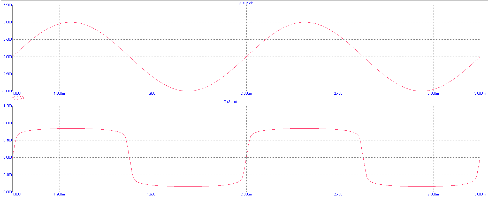

# mc9py

**Script Micro-Cap 9 from Python.** Describe or open a circuit, run analyses, get the numbers, and take screenshots that are
**MC9's own pictures** - with its cursors, cursor tables and voltage boxes. Works on Linux (sandboxed Wine) and Windows.

<div class="grid cards" markdown>

- **Native pictures** - plots and schematics are MC9's own pixels. Nothing is re-plotted, so they are exactly what teachers expect.
- **Real numbers** - every value comes from MC9's numeric output: operating points, AC/transient/DC tables, THD, Rin, Rout.
- **Circuits from code** - write a SPICE-like netlist and get a placed, routed, label-collision-free schematic.
- **Safe by design** - on Linux MC9 runs in a bubblewrap sandbox with no network and no access to your files.
- **AI-ready** - a built-in MCP server lets an assistant build, simulate and photograph circuits for you.

</div>

```python
import mc9
from mc9 import measure

c = mc9.library.ce_amplifier().build("amp")              # a common-emitter stage, drawn automatically
print(c.op()["Q1"]["IC"])                                 # 7.089e-03  (A)
bw = measure.bandwidth(c, "db(v(ua)/v(ue))", cursors=True)   # -3 dB band; MC9's cursors on the edges
c.shot("response.png")                                    # MC9's own plot with its cursor table
```

## Gallery

Everything below was produced by scripts - the circuits were placed automatically and every picture is a screenshot of MC9.

| | |
|---|---|
|  |  |
|  |  |
|  |  |

## Where to go

- New here? [Install](getting-started/install-linux.md) and run the [quickstart](getting-started/quickstart.md).
- Doing a lab? [Analyses](guide/analyses.md) -> [Cursors and screenshots](guide/screenshots.md) -> [Measurements](guide/measurements.md).
- Drawing circuits? [Automatic placement](guide/autoplace.md) or the [Schematic builder](guide/schematics.md).
- Curious how it works? [Architecture](internals/architecture.md).

## Support matrix

| | Linux | Windows |
|---|---|---|
| Backend | Wine + Xvfb + bubblewrap sandbox | native, Win32 API |
| Tested | real MC9 (Russian GUAP 9.0.3) | Windows Python under Wine driving MC9; real-Windows reports welcome |
| UI language | calibrated for the Russian edition, other editions need a [calibration](internals/calibration.md) | independent |
| Python | 3.10 - 3.14 | 3.10 - 3.14 |

*Micro-Cap is a trademark of Spectrum Software. This project is independent, contains no MC9 code and needs your own licensed copy.*
